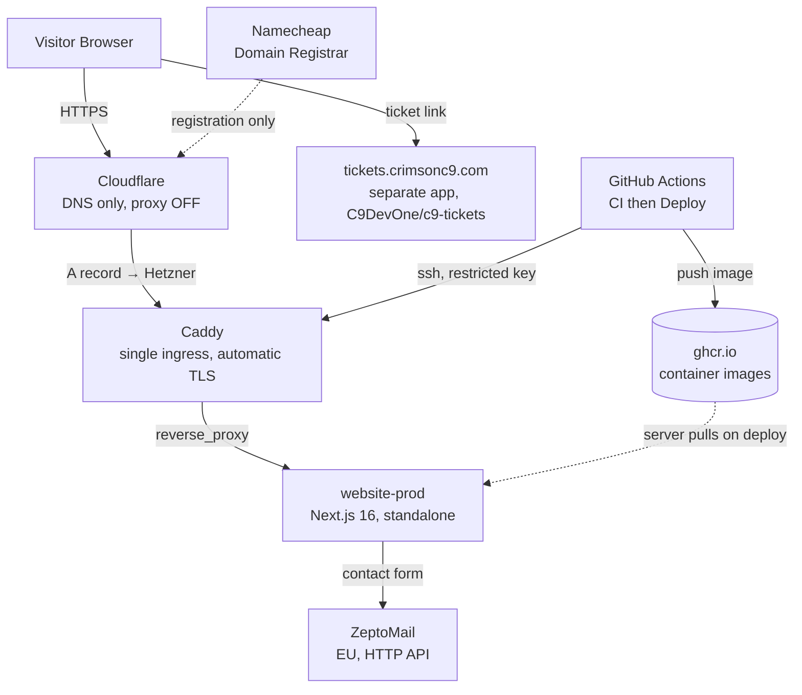

# CrimsonC9 — Tech Stack Overview

_Last updated: 2026-11-23_

Live, at-a-glance snapshot of what the project actually runs on today — kept current as the stack changes. For the reasoning behind any choice, see the matching ADR in [`/docs/adr/`](./adr/README.md). For deeper operational detail on a specific component, see the relevant `CONCEPT_*.md`.

## System Architecture

**Cloudflare's proxy is off for every hostname**, which is not an oversight: Caddy needs to answer the ACME challenge directly, and a proxied record would terminate TLS at Cloudflare with its own certificate.

**No database.** v1 renders from constants; see the Payload note below.

## Stack by Layer

| Layer              | Technology                      | Role                                                                                                                                                        | More detail                                                   |
| ------------------ | ------------------------------- | ----------------------------------------------------------------------------------------------------------------------------------------------------------- | ------------------------------------------------------------- |
| Framework          | Next.js 16 (App Router)         | React framework — SSR/RSC. React 19, React Compiler, `cacheComponents`, `output: "standalone"` for the container image                                      | [ADR-0001](./adr/0001-nextjs-app-router.md)                   |
| Language           | TypeScript                      | Every file is `.ts`/`.tsx`                                                                                                                                  | —                                                             |
| Styling            | Tailwind CSS v4                 | Utilities plus a hand-written layer in `globals.css` for the type scale, starfield, lantern and motion                                                      | —                                                             |
| Components         | Radix UI + shadcn (scaffolding) | Unstyled accessible primitives; shadcn's CLI scaffolds, then gets out of the way                                                                            | [ADR-0010](./adr/0010-shadcn-scaffolding-on-radix.md)         |
| Animation          | CSS                             | The whole motion system is CSS — reveals, starfield, lantern, sheen. `framer-motion` survives in `DecryptedText` only                                       | [ADR-0008](./adr/0008-animation-library-framer-vs-gsap.md)    |
| WebGL              | ogl                             | Backs the artist page's `CircularGallery` — dormant with that route, not loaded by anything live                                                            | —                                                             |
| Fonts              | Self-hosted woff2               | Cinzel Decorative (hero), Philosopher (headings + body), DM Sans (labels). Vendored in `src/fonts/` — **no build fetches Google**                           | `src/fonts/README.md`                                         |
| Icons              | lucide-react + react-icons      | UI icons / brand-social icons, kept deliberately separate                                                                                                   | —                                                             |
| CMS                | Payload CMS                     | **Dormant in v1.** Out of routing under `src/app/_payload`; collections, access rules and the initial migration are untouched. Returns with the artist page | [ADR-0002](./adr/0002-payload-cms-over-sanity.md)             |
| Database           | Postgres (via Supabase)         | **Not used in v1** — nothing connects. Comes back with Payload                                                                                              | [ADR-0003](./adr/0003-postgres-via-supabase.md)               |
| Media storage      | Backblaze B2                    | **Never wired, and nothing uploads today.** Specced only                                                                                                    | [ADR-0004](./adr/0004-backblaze-b2-media-storage.md)          |
| Hosting            | Hetzner + Docker                | `website-prod` container on the shared server, behind Caddy. Also runs c9-hub, Docmost, PhenoQuest and the ticket shop                                      | [ADR-0005](./adr/0005-vercel-hosting.md), `C9DevOne/c9-infra` |
| Ingress / TLS      | Caddy                           | Single entry point, automatic Let's Encrypt. Config in `C9DevOne/c9-infra`                                                                                  | `C9DevOne/c9-infra`                                           |
| CI / CD            | GitHub Actions → GHCR → SSH     | CI gates Deploy; Deploy builds the image, pushes to GHCR and runs `deploy.sh` over a restricted key. Healthcheck-gated rollback                             | `.github/workflows/`, `deploy/`                               |
| Environments       | prod + staging                  | `main` goes live automatically; `staging.crimsonc9.com` is manual, behind the team login, and can deploy **any branch**                                     | `deploy/`                                                     |
| Transactional mail | ZeptoMail (Zoho, EU)            | Contact-form delivery. Same provider as the ticket shop, one verified domain                                                                                | `src/lib/zeptomail.ts`                                        |
| Ticketing          | Stripe, in a separate app       | `tickets.crimsonc9.com` — `C9DevOne/c9-tickets`. This site links out to it                                                                                  | [ADR-0009](./adr/0009-pretix-ticketing.md)                    |
| DNS                | Cloudflare                      | DNS only, proxy **off** on every record                                                                                                                     | [ADR-0006](./adr/0006-cloudflare-dns-namecheap-registrar.md)  |
| Domain registrar   | Namecheap                       | Registration only                                                                                                                                           | [ADR-0006](./adr/0006-cloudflare-dns-namecheap-registrar.md)  |
| Version control    | GitHub                          | Conventional Commits, Linear-linked branch names                                                                                                            | `CONTRIBUTING.md`                                             |
| Project management | Linear                          | Workspace CrimsonC9, teams "CrimsonC9 Website" (CRI) and "Ticket Shop" (TIC)                                                                                | —                                                             |
| AI-assisted coding | Claude Code, Gemini CLI         | Primed via `AGENTS.md`                                                                                                                                      | —                                                             |
| Inbox              | Zoho Mail                       | `hello@crimsonc9.com`                                                                                                                                       | —                                                             |

## Notes on the table

**Hosting — Vercel → Hetzner.** ADR-0005 chose Vercel to avoid an operations burden. That burden now exists regardless, and is already paid for: the team runs a Hetzner box for c9-hub, Docmost, PhenoQuest and the ticket shop. Moving the site onto it removed a provider rather than adding one. See the ADR's own update note.

**Animation — neither Framer nor GSAP won.** ADR-0008 framed the choice as Framer Motion vs GSAP. The redesign answered it by needing neither: the motion is CSS, and GSAP, Lenis, Three.js and React Three Fiber were removed from `package.json` on 2026-11-23 after a check found zero imports of any of them.

**Component layer — Radix + shadcn.** [ADR-0007](./adr/0007-radix-tailwind-component-layer.md) originally set shadcn aside in favour of hand-built Radix primitives. [ADR-0010](./adr/0010-shadcn-scaffolding-on-radix.md) supersedes it: shadcn's CLI is used to scaffold new components (it generates a Radix-based file into the repo, then gets out of the way — not a runtime dependency), and every generated component's colour tokens are reskinned to reference the brand tokens rather than left as shadcn's defaults.
